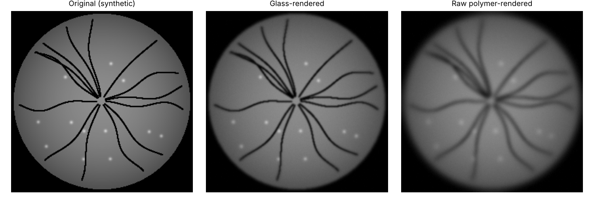

# FrugalOptiX: replace glass with code

**Group:** Team Cortex (Shivanee Shrivas, Anshika Singh)
**College:** IIT Kanpur
**Theme:** Theme 1, AI/ML for Advanced Frugal Innovation (AFI)
**Event:** ZEISS India Campus Hackathon, BeyondCode'26. **Stage:** mid-progress update

FrugalOptiX is an AI design engine that designs a simpler, molded polymer retinal lens together with a small restoration network, then tests with one fair benchmark whether the simpler lens still lets a classifier find disease.

> Honesty rule from Round 1: every number carries one label, **Measured**, **Simulated**, **Estimated** or **Target**. Nothing here is clinical validation or a medical device.

## Status at mid-progress

| Stage (Round 1) | Status | Evidence in this repo |
|---|---|---|
| Frozen requirement sheet | Done (FOV reduced, see below) | `configs/requirement_sheet.yaml` |
| 4-element glass baseline in Optiland | Done, simulated | `configs/designs.json`, `scripts/run_baselines.py` |
| 2-element polymer (PMMA + polycarbonate) raw baseline | Done, spherical start | same |
| Field-dependent render pipeline | v0 done (Gaussian-spot approximation) | `frugaloptix/render.py` |
| Cost / mass / CO2 model with low/base/high | Structure done, **coefficients are placeholders** | `frugaloptix/costmodel.py` |
| Evaluation protocol (fixed operating point, bootstrap CIs, paired test) | Done, unit-tested on synthetic scores | `frugaloptix/evaluation.py`, `tests/` |
| Seeded splits + SHA-256 manifest | Done, not yet run on RFMiD/IDRiD | `scripts/make_splits.py` |
| Restorer + lesion-detection loss, aspheric co-design | **Next** (Day 3-4) | not started |
| Held-out evaluation of conditions A to D | **Not run** (Day 5) | none |
| Android timing, dashboard | Planned (Day 6-7) | none |

## What the code measures so far (all Simulated or Estimated)

Run `python scripts/run_baselines.py`; the output is `results/benchmark.md`.

| Metric | Glass, 4 elements | Raw polymer, 2 elements | Label |
|---|---|---|---|
| RMS spot radius, on-axis / 50% field / edge (um) | 10.6 / 9.1 / 19.3 | 31.0 / 25.0 / 48.3 | Simulated |
| Lens mass (glass = 100) | 100 | 15.9 | Simulated |
| PSNR / SSIM on a **synthetic** image | 25.3 dB / 0.866 | 20.9 dB / 0.666 | Simulated, pipeline check only |
| Unit cost, CO2 | 100 | **placeholder ranges, not quoted** | Estimated |
| Disease-detection AUC (A/B/C/D) | not run | not run | Target |



**What this tells us.** The raw 2-element polymer lens is about 2.5x blurrier than the 4-element glass lens in simulation and weighs far less. That gap is the problem the restorer and the task-aware co-design must close. We do not yet know whether it will.

## Deviations from Round 1 (stated openly)

- **Field of view reduced from the 40 degree target to 20 degrees full field, for both lenses.** Round 1 allowed this ("if reduced, reduced for both"). Wider fields did not converge with spherical surfaces and our simple optimiser.
- **Render uses a Gaussian approximation** of the Optiland spot size per field zone, not a full wave PSF. Planned upgrade.
- **Cost and CO2 coefficients are placeholders**, not sourced values, so those numbers are not claimed.
- **Datasets are not committed.** RFMiD and IDRiD need an IEEE DataPort account and their data-use terms; the synthetic image is only for exercising the pipeline.

## Quick start

```bash
pip install -r requirements.txt
pytest -q                           # 6 tests
python scripts/run_baselines.py     # glass vs raw polymer benchmark -> results/
python scripts/run_baselines.py --reoptimise   # redo the radius optimisation (~2 min)
python scripts/make_splits.py --labels data/RFMiD/labels.csv --images data/RFMiD/images
```

## Layout

```
frugaloptix/  optics.py render.py evaluation.py costmodel.py splits.py labels.py synthetic.py
configs/      requirement_sheet.yaml  designs.json
scripts/      run_baselines.py  make_splits.py
tests/        test_core.py
results/      benchmark.md / .json, render_comparison.png
```

## Next steps

1. Mount RFMiD/IDRiD, build checksummed splits, train the classifier on original images (condition A).
2. Two-element aspheric polymer lens plus small restorer, trained end to end with a lesion-detection loss and molding-error noise (PyTorch, Optiland torch backend).
3. One held-out evaluation of all four conditions with the fixed operating point and confidence intervals.
4. Sourced cost/CO2 coefficients, trade-off dashboard, on-phone ONNX timing.
5. If the 2-element lens fails its criteria, report it and show the 3-element fallback.

## Limitations

No physical prototype; simplified optics (no illumination path, no birefringence or stray light); public images were already captured through real optics; the glass baseline is a representative open design, not a ZEISS product; public datasets are not clinical validation.
