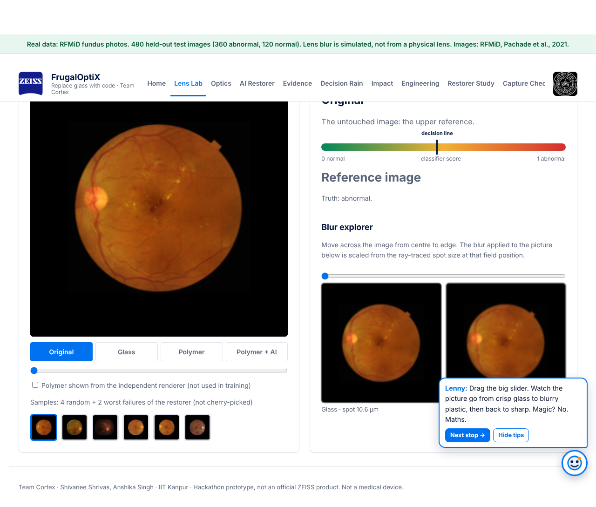

# FrugalOptiX: replace glass with code

**Group:** Team Cortex: Shivanee Shrivas (Roll no. 230974), Anshika Singh (Roll no. 230163)
**College:** IIT Kanpur
**Theme:** Theme 1, AI/ML for Advanced Frugal Innovation (AFI)
**Event:** ZEISS India Campus Hackathon, BeyondCode'26. **Stage:** final submission (25 Nov 2026)

FrugalOptiX is an AI design engine for a cheaper retinal (fundus) camera lens. It replaces a 4-element ground-glass lens with a 2-element molded plastic lens plus a 0.5 MB neural restorer. It then tests, with one pre-declared benchmark on **real RFMiD fundus photos**, whether a disease classifier still works through the cheaper lens.

- **Final presentation:** [`docs/FrugalOptiX_Final_TeamCortex.pdf`](docs/FrugalOptiX_Final_TeamCortex.pdf)
- **Real-data run (Kaggle GPU, with outputs):** [`notebooks/kaggle_rfmid_real_run.ipynb`](notebooks/kaggle_rfmid_real_run.ipynb)
- **All numbers:** [`results/results.json`](results/results.json) and the other files in `results/`
- **Interactive demo (Lens Lab, 12 pages):** `python -m http.server 8000 --directory web`, then open http://localhost:8000

> **Honesty rule:** every number has one label: **Measured** (held-out test set or timing), **Simulated** (ray-traced optics), **Estimated** (cost/CO2 model with assumed inputs). The lens blur is simulated; the photos are real. This is not clinical validation and not a medical device.



## Headline results: real RFMiD run

Test set: **480 held-out RFMiD photos** (360 abnormal, 120 normal), 256 px, opened once. Kaggle GPU, seed 0, 20 restorer epochs, total run 202 min. Every pipeline is scored by the same frozen classifier trained on glass-lens images; the threshold is set at 90% specificity on each pipeline's own validation split. **Measured.**

| Pipeline (nominal blur) | AUC (95% CI) | Sensitivity | Specificity |
|---|---|---|---|
| Original photos (upper bound) | 0.987 (0.978–0.994) | 95.0% | 91.7% |
| **Glass lens, 4 elements** (reference) | **0.980** (0.968–0.989) | 94.4% | 88.3% |
| **Plastic lens + AI restorer (ours)** | **0.970** (0.954–0.984) | **95.0%** | 84.2% |
| Plastic lens, classifier retrained on plastic | 0.952 (0.930–0.971) | 88.1% | 91.7% |
| Plastic lens, raw | 0.949 (0.926–0.970) | 89.7% | 87.5% |
| Plastic lens + Wiener deblur | 0.924 (0.894–0.951) | 81.9% | 87.5% |

- The restorer closes about **two-thirds of the AUC gap** to glass (gap 0.031 → 0.010).
- It beats the best non-AI alternative (selected on validation: the retrained classifier) by **+0.018 AUC** (95% CI +0.002 to +0.035).
- Image fidelity (PSNR vs original): raw plastic 32.9 dB → restored 40.2 dB (glass 37.9 dB).

### Pre-declared non-inferiority test

Rule (declared 19 Nov in `configs/acceptance.yaml`, before results): lower 99.6% bound of the AUC difference vs glass > −0.05 **and** upper bound of the false-positive-rate difference ≤ +0.05 (Bonferroni over 12 tests).

| Pipeline vs glass | AUC diff (99.6% CI) | AUC rule | FPR rule | Verdict |
|---|---|---|---|---|
| Plastic + AI, ray-traced PSF blur | −0.006 (−0.015, +0.002) | pass | pass | **Pass** |
| Plastic, raw, ray-traced PSF blur | −0.005 (−0.011, −0.000) | pass | pass | **Pass** |
| Plastic + AI, nominal blur | −0.010 (−0.022, 0.000) | pass | fail (+4 pts FPR) | Not shown |
| Plastic, raw, nominal blur | −0.031 (−0.054, −0.012) | fail | fail | Fail |
| Plastic + AI, unseen blur model | −0.033 (−0.057, −0.016) | fail | fail | Fail |

Full table for all 12 comparisons: `results/results.json` → `noninferiority`.

## The lens (Simulated, Optiland ray tracing, 3 wavelengths, 20° field)

| | Glass reference | Plastic (ours) |
|---|---|---|
| Elements | 4 (N-BK7, N-SF5), spherical | **2, aspheric, one resin (Zeonex)** |
| Lens mass | 2.22 g | **0.28 g (−87%)** |
| RMS spot, centre / 50% field / edge | 10.6 / 9.1 / 19.3 µm | 17.1 / 19.5 / 48.9 µm |
| Molding yield at a 3× glass blur limit, 800 Monte-Carlo draws | n/a | 99.6% precision-grade tolerance, 84.0% commercial grade (0% at the pre-declared 2× limit) |

- **Where the AI looks:** Grad-CAM on 300 diseased training/validation eyes gives field weights centre 1.39 / mid 1.00 / edge 0.61, so the lens is optimised to be sharpest at the centre (`results/saliency.json`).
- **Material search:** 5 polymer pairs; Zeonex+Zeonex is on the Pareto front (sharpest weighted spot 24.3 µm, lightest 0.28 g, single resin) (`results/design_study.json`).
- **Design X-ray of the glass lens:** removing element 4 adds the least blur (+10.4 µm), element 3 the most (+31.0 µm).
- Aspheric surfaces cut centre blur 45% vs the spherical 2-element start (31.0 → 17.1 µm).

## Frugality: cost, carbon, compute

| Metric | Value | Label |
|---|---|---|
| Camera-module cost at 10k units, glass → plastic + AI (median) | $201 → $88 (**−$112, −56%**); plastic cheaper in 100% of Monte-Carlo draws | Estimated |
| Same at 1k units | $209 → $243 (plastic more expensive: molds need volume) | Estimated |
| CO2, optics + mount, cradle to grave, 10k units | 4.2 → 0.9 kg CO2e per module (**−78%**) | Estimated |
| Mass | optics −87%; whole camera only −5% (electronics dominate) | Simulated |
| Restorer | 118,947 parameters; ONNX 0.50 MB (int8 0.17 MB) | Measured |
| Restorer speed | 64 ms/image on one CPU thread (ONNX Runtime); 1.4 ms on GPU | Measured, build machine, not a phone |
| Quality gate | rejects 100% of over-blurred, under-exposed and half-retina stress images; 2.3% false rejects on good images | Measured |

Cost and CO2 inputs are ranges in `configs/cost_inputs.yaml`. Most rows are **assumed**; tooling uses a published range (Apollo Optical). Replace them with supplier quotes and rerun `scripts/09_cost_lca.py`.

## Open issues (stated first)

- **Independent judge:** a separately trained MobileNet sees no AUC gain from the restorer (−0.003, 95% CI −0.028 to +0.023). The 0.970 is scored by the same classifier the restorer was tuned against, so it needs outside confirmation.
- **Restoration is not claimed:** RFMiD has no lesion masks, so lesion recall and invented-lesion checks could not be run (`results/results.json` → `restoration_claims`).
- **Edge sharpness:** polymer MTF falls to 0.16× glass at the field edge vs a 0.70× target, so the optical acceptance check fails.
- **False positives:** +4 points vs glass at nominal blur.
- **Unseen blur model:** the quality gate rejects all independent-renderer images (limits were fitted on nominal images).
- **Simulated optics:** no physical lens yet; field of view reduced from 40° to 20° for both lenses (allowed by the Round 1 plan); single seed.

## Reproduce

```bash
pip install -r requirements.txt
pytest -q                                             # 19 unit tests
bash scripts/run_all.sh synthetic                     # ~15 min CPU smoke test (NOT scientific)
python scripts/merge_rfmid.py --root <RFMiD folder> --out data/RFMiD --max-side 768
bash scripts/run_all.sh rfmid data/RFMiD --pretrained # real run on a GPU (our Kaggle run took 202 min)
python -m http.server 8000 --directory web            # demo; phone timing page: /bench.html
```

The exact Kaggle run, with its full log, is in `notebooks/kaggle_rfmid_real_run.ipynb`. Details: [RUNNING.md](RUNNING.md).
Pipeline order: design study → render glass/plastic → classifiers → Grad-CAM saliency → field-weighted design → three blur renderers (nominal, independent, ray-traced PSF) → baselines + restorer study (validation only) → **one** test-set evaluation → ONNX export → cost/LCA → deployment benchmark → web assets.

## Layout

```
frugaloptix/   optics, render, psfmodel, tolerance, materials, mfg, saliency, ml, train, quality, evaluation, costmodel, ...
scripts/       run_all.sh and numbered pipeline steps (00–13), merge_rfmid.py, make_splits.py
configs/       requirement_sheet.yaml, acceptance.yaml (pre-declared rules), cost_inputs.yaml, designs.json
results/       results.json (real RFMiD run) and optics, design, cost, deployment, saliency outputs
web/           Lens Lab interactive demo (real-run results in web/data/results.js), ONNX model in web/models/
notebooks/     kaggle_rfmid_real_run.ipynb (executed, with log), FrugalOptiX_Colab.ipynb
kaggle_run.ipynb  blank Kaggle template of the same run
docs/          final presentation, RFMID_RESULTS.md, RESTORER_STUDY.md, clinical roadmap, model-eye bench plan, screenshots
tests/         unit tests (run in CI on every push)
test_photos/   example good/bad captures for the quality gate
_synthetic_backup/  archive, not final results: mid-progress benchmark + synthetic smoke-test outputs
```

Datasets are not included. RFMiD: Pachade et al., "Retinal Fundus Multi-Disease Image Dataset (RFMiD)", *Data* 2021; check its licence before redistributing images.

## Next steps

1. Diamond-turned Zeonex prototype measured on a model-eye bench (`docs/MODEL_EYE_BENCH.md`, `scripts/08_real_capture_eval.py`).
2. IDRiD lesion masks, so restoration can be tested and either claimed or rejected.
3. Third element or wider-field redesign if edge MTF cannot reach the target.
4. Phone timing via `web/bench.html`, supplier quotes for cost/CO2, three seeds.

## Limitations

No physical prototype; simplified optics (no illumination path, birefringence or stray light); public photos were already captured through real optics; the glass baseline is a representative open design, not a ZEISS product; public datasets are not clinical validation. Hackathon prototype, not an official ZEISS product.
